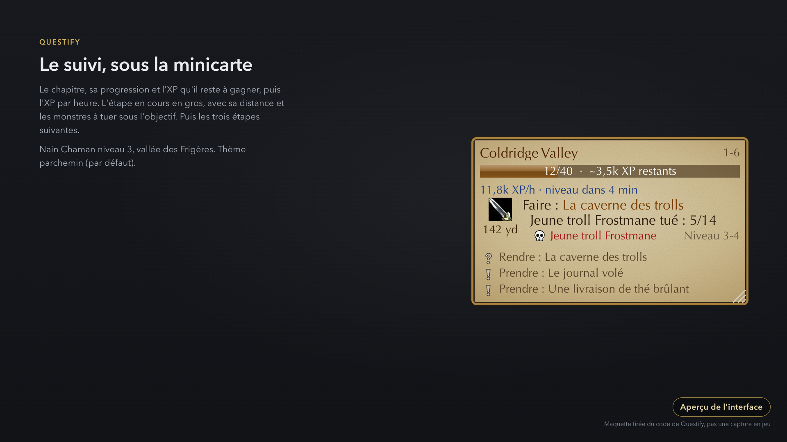
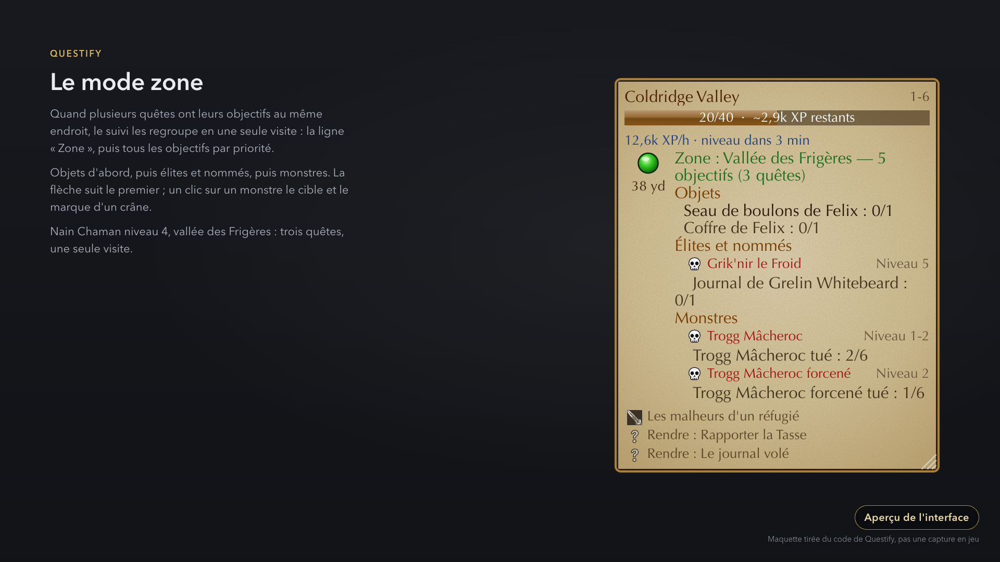
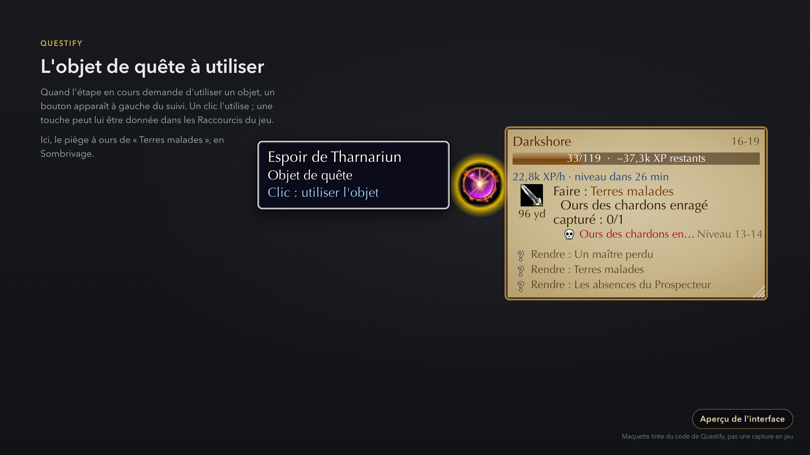
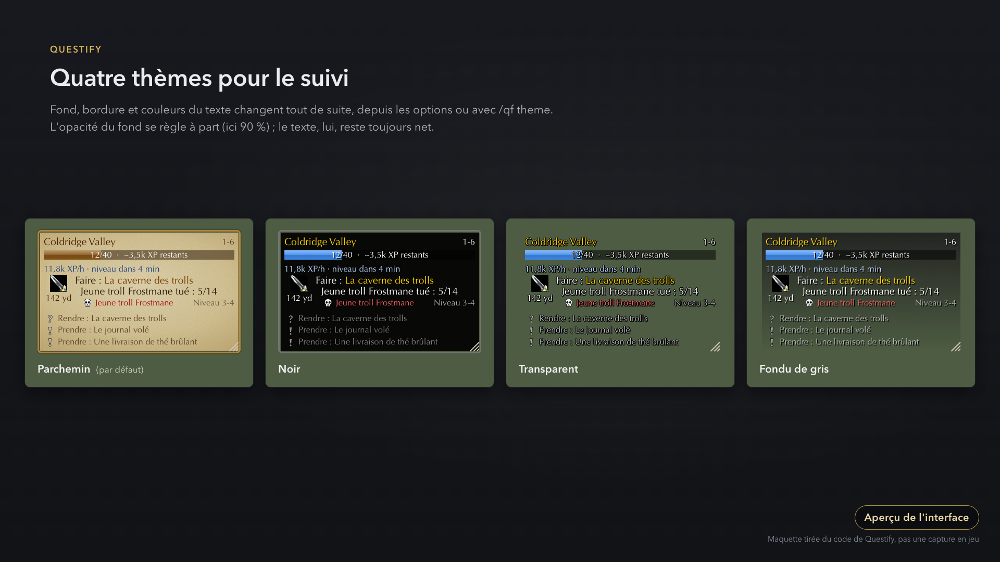
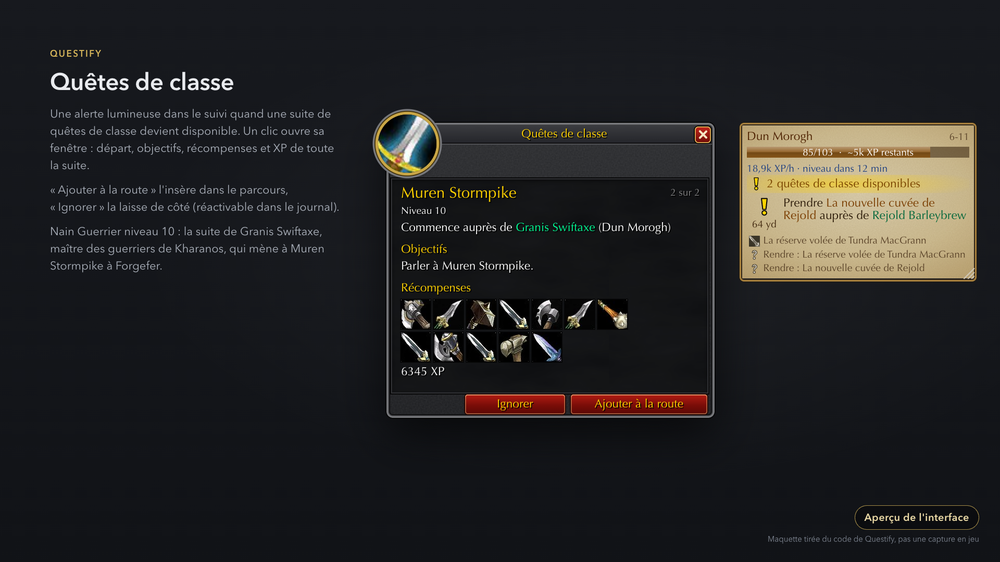
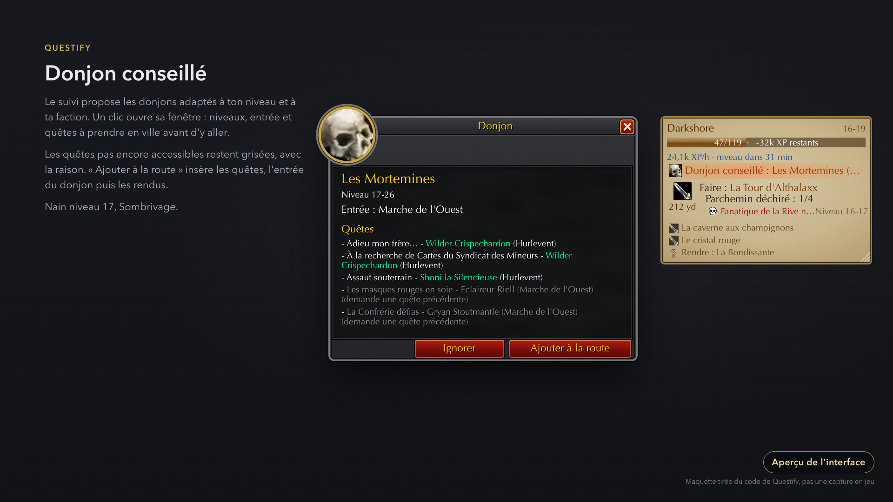
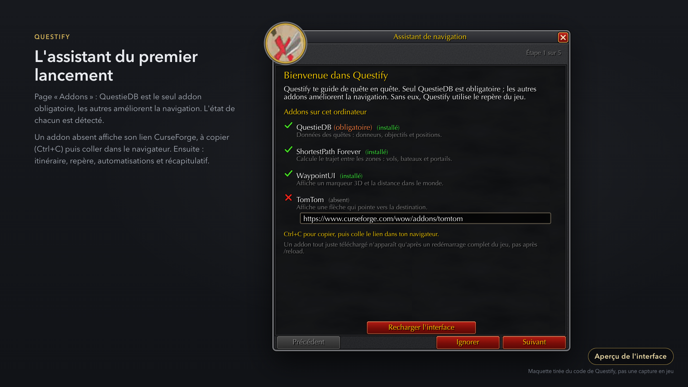
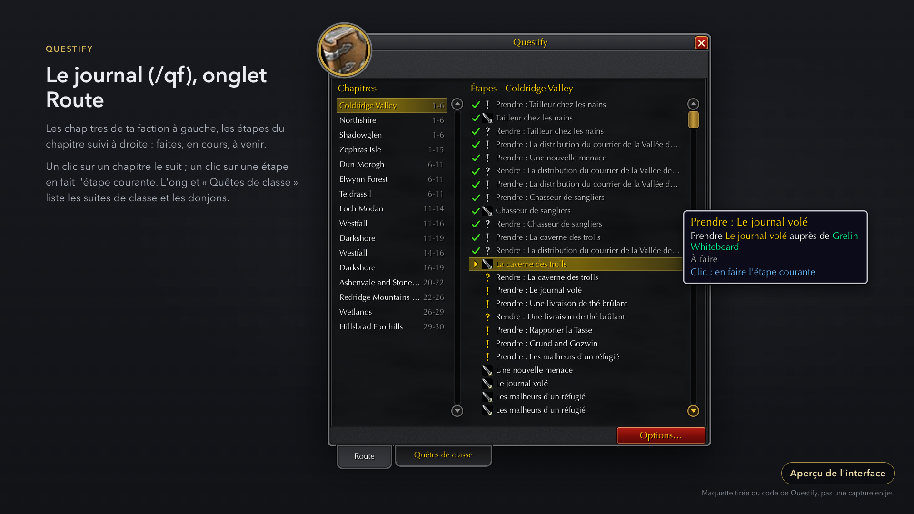
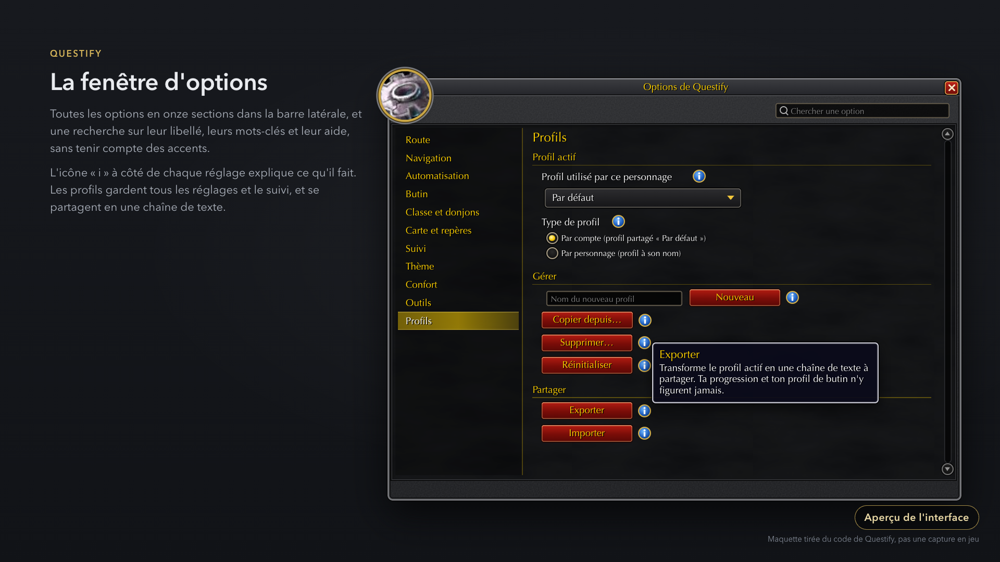

# Galerie / Gallery

Captures et vidéos à venir. Les fichiers vont dans `docs/media/` (liste des prises de vue :
[`docs/media/README.md`](https://github.com/GeoffreySanchez/questify/blob/main/docs/media/README.md)).
*Screenshots and videos coming soon. Files go in `docs/media/` (shot list in `docs/media/README.md`).*

<!-- Quand les fichiers existent, décommenter / When the files exist, uncomment:

-->

## Aperçus de l'interface / Interface previews

En attendant les vraies captures, voici des **maquettes** de l'interface, dessinées d'après le code
de l'addon : ce ne sont pas des captures en jeu, elles seront remplacées par les vraies.
*Until the real screenshots arrive, here are **mock-ups** of the interface, drawn from the addon's
code: they are not in-game captures and will be replaced by the real ones.*

### Le suivi / The tracker
Sous la minicarte : chapitre, progression, XP par heure, étape en cours avec sa distance et les
monstres à tuer, puis les étapes suivantes.
*Under the minimap: chapter, progress, XP per hour, current step with its distance and the monsters
to kill, then the next steps.*

### Le mode zone / Zone mode
Plusieurs quêtes au même endroit : une seule visite, objectifs groupés (objets, élites et nommés,
monstres).
*Several quests in the same place: one visit, objectives grouped (items, elites and named, monsters).*

### L'objet de quête / The quest item
Un bouton à gauche du suivi pour l'objet que l'étape demande d'utiliser.
*A button left of the tracker for the item the step asks you to use.*

### Les thèmes du suivi / Tracker themes
Parchemin (par défaut), Noir, Transparent et Fondu de gris.
*Parchment (default), Black, Transparent and Grey fade.*

### Quêtes de classe / Class quests
L'alerte du suivi et la fenêtre de la suite : départ chez le maître le plus proche, objectifs,
récompenses, « Ajouter à la route » ou « Ignorer ».
*The tracker alert and the chain window: start at the nearest trainer, objectives, rewards, "Add to
route" or "Ignore".*

### Donjon conseillé / Suggested dungeon
L'alerte du suivi et la fenêtre du donjon, avec les quêtes à prendre en ville.
*The tracker alert and the dungeon window, with the quests to pick up in town.*

### L'assistant / The wizard
Premier lancement, page Addons : un addon absent affiche son lien CurseForge.
*First start, Addons page: a missing addon shows its CurseForge link.*

### Le journal / The journal
`/qf`, onglet Route : chapitres à gauche, étapes à droite.
*`/qf`, Route tab: chapters on the left, steps on the right.*

### Les options / Options
Sections, recherche, icône « i » sur chaque réglage, profils à partager.
*Sections, search, an "i" icon on each setting, shareable profiles.*

